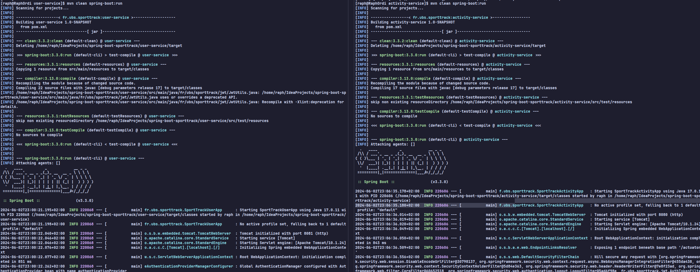
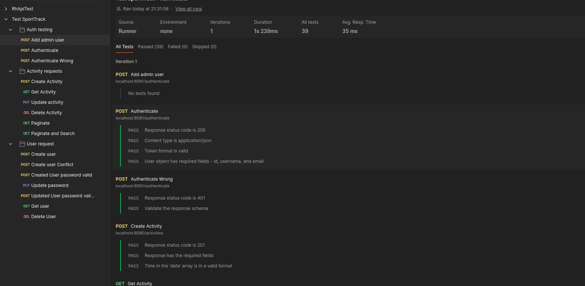

# TP Implementation de micrservices avec Spring Boot
**Par : Raphael AIME 3A1**

## Introduction
Ce projet est un TP de microservices utilisant Spring Boot. L'objectif est de créer deux microservices :
- Un microservice qui permet de gérer des activités sportives.
- Un microservice qui permet de gérer des utilisateurs ainsi que l'authentification JWT.

**Le projet utilise la version 17 de Java.**

## Structure du projet
Le projet utilise la fonctionnalité de modules de Maven. Dans le répertoire principal, vous trouverez :
- `activity-service` : Le microservice qui gère les activités.
- `user-service` : Le microservice qui gère les utilisateurs.
- Un fichier `pom.xml` parent qui permet de construire et gérer les versions des dépendances.

## Configuration
Chaque microservice utilise des profils Spring (dev et prod) pour la configuration. Le profil "dev" est utilisé pour le développement local.

Les fichiers de configuration principaux sont :
- `application.properties` : Contient les valeurs par défaut.
- `application-dev.properties` : Configuration spécifique au profil de développement.
- `application-prod.properties` : Configuration spécifique au profil de production.

Ils se trouvent dans le dossier `resources` de chaque microservice. Les valeurs par défaut sont renseignées dans le fichier `application.properties`, et par rapport au profil, les valeurs spécifiques sont renseignées dans les fichiers `application-dev.properties` et `application-prod.properties` en priorité. Par exemple dans les deux microservices, vous pouvez voir que le port par défaut est 8080, mais pour le profil de développement, le port est 8081, et cela est défini dans le fichier `application-dev.properties` qui remplace la valeur par défaut. (Qui est 8080 ou la variable d'environnement `PORT`)

### Propriétés importantes de configuration

**Pour les deux microservices :**
- `server.port` : Le port sur lequel le serveur écoute.
- `spring.profiles.active` : Le profil actif (dev ou prod). (Est défini automatiquement par Maven si vous utiliser la commande `mvn spring-boot:run ...`)
- `jwt.secret` : La clé secrète pour les tokens JWT (doit être identique pour les deux microservices).

- `spring.jpa.hibernate.ddl-auto` : La stratégie de génération de la base de données. (validate (par défaut), update, create, create-drop)
- `spring.jpa.properties.hibernate.dialect` : Le dialecte de la base de données.
- `spring.datasource.url` : L'URL de la base de données.
- `spring.datasource.username` : Le nom d'utilisateur de la base de données.
- `spring.datasource.password` : Le mot de passe de la base de données.

**Pour le microservice d'utilisateurs :**
- `admin.username` : Le nom d'utilisateur de l'administrateur créé automatiquement.
- `admin.email` : L'email de l'administrateur créé automatiquement.
- `admin.password` : Le mot de passe de l'administrateur créé automatiquement.
- `admin.auto-create` : Créer automatiquement un utilisateur administrateur au démarrage à partir des valeurs ci-dessus. (true ou false)

### Utilisation des variables d'environnement
Certaines partie de la configuration peuvent être définies par des variables d'environnement. Par exemple, le port du serveur peut être défini par la variable `PORT`. Si la variable est définie, elle remplace la valeur par défaut. Cela permet de définir des valeurs spécifiques à l'environnement sans avoir à modifier les fichiers de configuration.

Voici les autre variables d'environnement que vous pouvez définir :
- `JWT_SECRET` : La clé secrète pour les tokens JWT (`jwt.secret`).
- `ST_ADMIN_USERNAME` : Le nom d'utilisateur de l'administrateur créé automatiquement (`admin.username`).
- `ST_ADMIN_EMAIL` : L'email de l'administrateur créé automatiquement (`admin.email`).
- `ST_ADMIN_PASSWORD` : Le mot de passe de l'administrateur créé automatiquement (`admin.password`).
- `AUTO_CREATE_ADMIN` : Créer automatiquement un utilisateur administrateur au démarrage à partir des valeurs ci-dessus (`admin.auto-create`).
- `PORT` : Le port sur lequel le serveur écoute (`server.port`).
- `DB_HOST` : L'hôte de la base de données (`spring.datasource.url`).
- `DB_PORT` : Le port de la base de données (`spring.datasource.url`).
- `DB_NAME` : Le nom de la base de données (`spring.datasource.url`).
- `DB_USERNAME` : Le nom d'utilisateur de la base de données (`spring.datasource.username`).
- `DB_PASSWORD` : Le mot de passe de la base de données (`spring.datasource.password`).
- `DDL_AUTO` : La stratégie de génération de la base de données (`spring.jpa.hibernate.ddl-auto`).

## Utilisation

Pour lancer les microservices, il suffit d'exécuter la commande suivante dans le dossier de chaque microservice :
```bash
mvn clean spring-boot:run -Dspring-boot.run.profiles=dev
```

Bien sur si vous voulez lancer la version de production, il suffit de changer le profil par `prod` :
```bash
mvn clean spring-boot:run -Dspring-boot.run.profiles=prod
```



Les ports définie pour le profil de développement sont :
- `activity-service` : 8081
- `user-service` : 8080

## Fonctionnalités
- CRUD sur les activités. (Pour le microservice d'activités)
- CRUD sur les utilisateurs. (Pour le microservice d'utilisateurs)
- Authentification JWT.
- Pagination des résultats. (Pour les deux microservices)
- Filtrage des résultats. (Pour les deux microservices)
- Tri des résultats. (Pour les deux microservices)

## Swagger
Chaque microservice utilise Swagger pour documenter les endpoints. Pour accéder à la documentation, il suffit de se rendre à l'URL suivante :
- `<url du microservice>/openapi/swagger-ui/index.html`

## Tests
Pour les tests, j'ai utilisé un outil utilisé en R4.02 : Postman.
J'ai pu créer une série de tests pour chaque microservice.

Un fichier `postman.json` est disponible pour que vous puissiez tester les endpoints. Après avoir importé le fichier dans Postman, vous pouvez exécuter la collection de tests. (Vérifier bien les variable de collection que vous venez d'importer)
Dans ces variables, seul `adminToken`, `activityId` et `userId` sont __PAS__ a modifier.
Pour que les tests fonctionnent, il faut faire en sorte qu'il y a un utilisateur avec comme nom d'utilisateur `admin` et comme mot de passe `admin` (par défaut). C'est l'utilisateur créé automatiquement au démarrage du microservice d'utilisateurs si la propriété `admin.auto-create` est à `true` et en laissant les valeurs par défaut.


## Package
Pour créer un package, il suffit de lancer la commande suivante dans le `pom` parent :
```
mvn clean package
```

Cela va créer les fichiers JAR dans les dossiers `target` des microservices.

D'accord, je vais ajouter ces informations au README en deux parties distinctes. Voici comment je structurerais ces ajouts :


## API Gateway

Le projet inclut également une API Gateway qui agit comme un point d'entrée unique pour tous les microservices. L'API Gateway est configurée pour router les requêtes vers les services appropriés en fonction des chemins d'URL.

### Configuration

La configuration de l'API Gateway se trouve dans le fichier `application.yml`. Voici un exemple de configuration :

```yaml
server:
  port: 8080

spring:
  cloud:
    gateway:
      routes:
        - id: user-service
          uri: http://localhost:8081
          predicates:
            - Path=/ms-user/**
        - id: activity-service
          uri: http://localhost:8082
          predicates:
            - Path=/ms-activity/**
```

### Lancement

Pour lancer l'API Gateway, utilisez la même commande que pour les autres microservices :

```bash
mvn clean spring-boot:run -Dspring-boot.run.profiles=dev
```

L'API Gateway fonctionnera sur le port 8080 par défaut.

## Docker

Le projet est conteneurisé avec Docker pour faciliter le déploiement et l'exécution dans différents environnements.

### Dockerfiles

Il y a trois Dockerfiles dans le projet :

1. `activity-service.Dockerfile`
2. `user-service.Dockerfile`
3. `api-gateway.Dockerfile`

Chaque Dockerfile suit une structure similaire. Voici un exemple pour le service utilisateur (`user-service.Dockerfile`) :

```dockerfile
FROM maven:3.9.9-amazoncorretto-17-alpine AS build

WORKDIR /app/user-service

# parent pom
COPY ./pom.xml ../pom.xml
# copy user-service pom
COPY ./user-service/pom.xml ./pom.xml
COPY user-service/src ./src

RUN mvn clean package -DskipTests


FROM openjdk:17-jdk-alpine

WORKDIR /app

COPY --from=build /app/user-service/target/sporttrack-user-service.jar .

CMD ["java", "-jar", "sporttrack-user-service.jar"]
```

Ce Dockerfile utilise une approche multi-stage pour d'abord construire l'application avec Maven, puis créer une image légère contenant uniquement le JAR de l'application et le JRE nécessaire pour l'exécuter.

### Docker Compose

Un fichier `docker-compose.yml` est fourni pour orchestrer le déploiement de tous les services. Il inclut :

- L'API Gateway
- Le service utilisateur
- Le service d'activité
- Les bases de données MariaDB pour chaque service

Pour lancer l'ensemble de l'application avec Docker Compose, utilisez la commande suivante à la racine du projet :

```bash
docker compose up -d
```

Cela construira les images Docker si nécessaire et démarrera tous les conteneurs. L'application sera accessible via l'API Gateway sur le port 8080 de votre machine hôte.

*Note si vous avez une ancienne version de Docker, vous pouvez utiliser la commande `docker-compose` à la place de `docker compose`.*

Pour voir les logs de un ou plusieurs services, vous pouvez utiliser la commande suivante :

```bash
docker compose logs -f <service-name>
```
Sans préciser le nom du service, cela affichera les logs de tous les services.

Cette structure de commande fonctionne aussi pour `up` et `down` pour démarrer et arrêter des services spécifiques ou tous les services.
```bash
docker compose up -d <service-name>
docker compose down <service-name>
```

## Sécurisation des accès au backend

Pour sécuriser les accès au backend, plusieurs niveaux de contrôle d'accès peuvent être mis en place. Dans la structure actuelle du projet, nous appliquons déjà le principe de "Zero Trust" où chaque microservice vérifie indépendamment le token JWT. C'est une bonne pratique, mais nous pouvons aller plus loin pour renforcer la sécurité.

Voici les niveaux où le contrôle d'accès peut être mis en place :

1. **Au niveau de l'API Gateway** : L'API Gateway peut servir de premier point de contrôle en vérifiant l'authenticité des tokens JWT avant de router les requêtes vers les microservices. Elle peut également implémenter des contrôles de rate limiting pour prévenir les attaques par déni de service.

2. **Au niveau de chaque microservice** (comme c'est déjà le cas) : Chaque service vérifie indépendamment le token JWT, assurant ainsi une sécurité en profondeur. Les microservices peuvent implémenter des contrôles d'autorisation plus granulaires basés sur les rôles ou les permissions spécifiques à chaque service.

3. **Au niveau du réseau** : Utiliser des réseaux virtuels privés (VPN) ou des sous-réseaux isolés pour les communications entre microservices. Mettre en place des pare-feu pour contrôler le trafic entrant et sortant.

4. **Au niveau de l'infrastructure** : Utiliser des certificats SSL/TLS pour toutes les communications. Mettre en place une gestion centralisée des secrets (comme HashiCorp Vault) pour stocker de manière sécurisée les clés JWT et autres informations sensibles.

5. **Logging et Monitoring** : Implémenter un système de logging centralisé pour suivre toutes les tentatives d'accès et les activités suspectes. Mettre en place des alertes pour détecter les comportements anormaux.

